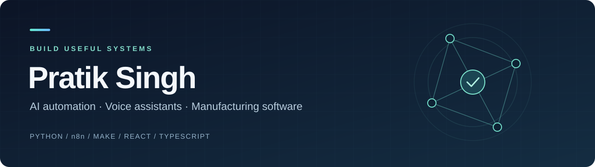

  

  <a href="https://github.com/pratiksingh03197-lang/jarvis-local-assistant/blob/main/README.md#run-the-live-web-demo-without-a-microphone"><strong>JARVIS demo guide</strong></a> ·
  <a href="https://kervo-manufacturing-ops.syrupyswift.chatgpt.site"><strong>Live Kervo website</strong></a> ·
  <a href="https://github.com/pratiksingh03197-lang/project-portfolio"><strong>Project portfolio</strong></a> ·
  <a href="https://www.upwork.com/freelancers/~017015f91a8905df56"><strong>Work with me</strong></a>

## Hi, I'm Pratik

I build AI assistants, workflow automations and software for everyday business operations. My background in FMCG e-commerce and quick commerce helps me connect technical work to the people and processes it needs to support.

At **GC Foods**, I handle AI decisions and functionality through development, integration and deployment, alongside e-commerce and quick-commerce responsibilities. My current focus is local voice assistants, manufacturing workflows and practical automation with Python, n8n and Make.

## Latest project · JARVIS desktop assistant

**A Windows voice and text assistant** built in Python, with Hindi, English and Hinglish support.

- Local wake-word activation, voice capture and speech recognition, with optional Gemini or Groq online transcription and chat.
- A desktop preview with typed chat, start/stop listening, microphone diagnostics, speech-language selection and spoken replies.
- Confirmed Google searches through SerpApi, with visible numbered source links and summaries grounded in returned excerpts.
- A fixed local action allowlist keeps Windows controls separate from cloud model responses.

**Status:** Working prototype under active development. The public repository now includes the latest Windows desktop source and setup guide. SerpApi live search requires your own private key; the live API path still needs validation with a configured key.

[Explore JARVIS source and setup →](https://github.com/pratiksingh03197-lang/jarvis-local-assistant)
[Open the live-search demo guide →](https://github.com/pratiksingh03197-lang/jarvis-local-assistant/blob/main/README.md#run-the-live-web-demo-without-a-microphone)

## Selected work

| Project | What I built | Current stage |
| --- | --- | --- |
| [Manufacturing operations & workforce SaaS](https://github.com/pratiksingh03197-lang/project-portfolio/blob/main/case-studies/manufacturing-operations.md) | Production planning, attendance, workstation ownership, task routing and reporting with React, TypeScript and PostgreSQL. | Functional beta |
| [Kervo product website](https://kervo-manufacturing-ops.syrupyswift.chatgpt.site) | A responsive B2B website presenting a manufacturing operations product. [Read the case study →](https://github.com/pratiksingh03197-lang/project-portfolio/blob/main/case-studies/kervo-website.md) | Published marketing site |
| [Make AI email workflow](https://github.com/pratiksingh03197-lang/project-portfolio/blob/main/case-studies/make-email-automation.md) | Gmail → Gemini AI → reply draft → Google Calendar workflow configuration. | Prototype; validation pending |
| [n8n sales-data automation](https://github.com/pratiksingh03197-lang/project-portfolio/blob/main/case-studies/n8n-sales-data.md) | Automation work supporting sales-data tasks. | Experience summary |
| [Personal planning dashboard](https://github.com/pratiksingh03197-lang/project-portfolio/blob/main/case-studies/personal-planning-dashboard.md) | Daily checklists, notes, scoring, reporting and JSON backups in a local web app. | Local implementation |
| [Internal AI assistant](https://github.com/pratiksingh03197-lang/project-portfolio/blob/main/case-studies/internal-ai-assistant.md) | Internal voice-assistant work for company directors. | Confidential work summary |

## Tools I work with

| Area | Tools and technologies |
| --- | --- |
| AI & voice | Python, Ollama, faster-whisper, openWakeWord, Gemini, Groq, SerpApi, speech processing |
| Workflow automation | n8n, Make, Gemini AI, Gmail, Google Calendar |
| Web applications | React, TypeScript, Vite, Tailwind CSS, TanStack |
| Data & backend | PostgreSQL, Supabase, Drizzle |
| Business context | FMCG, e-commerce, quick commerce, sales data, manufacturing operations |

## Let's build something useful

I'm open to **AI automation, assistant development and business workflow projects**. I enjoy turning a manual process into a clear, usable system, from understanding the requirement through implementation and deployment.

[Discuss a project on Upwork →](https://www.upwork.com/freelancers/~017015f91a8905df56)

Portfolio updated November 7, 2026. Project pages distinguish implemented features, prototypes and pending validation.
